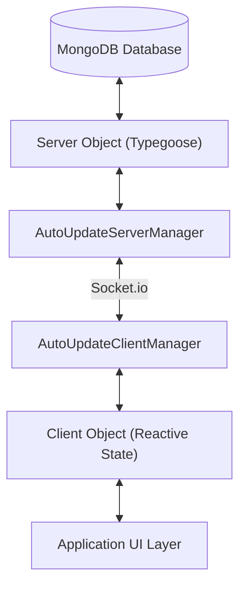

# DEM (Data Entity Manager)

Real-time reactive data synchronization library for TypeScript applications.

DEM connects MongoDB backend database collections to client applications through bidirectional WebSockets. Entities synchronize automatically when properties change.

---

## Architecture Overview



DEM isolates responsibilities into two distinct packages:
- **`@prestizni-software/client-dem`**: Lightweight client library with zero database dependencies.
- **`@prestizni-software/server-dem`**: Server synchronization engine with MongoDB and Typegoose integration.

---

## Core Features

### 1. Real-Time Synchronization
- Transmits entity property changes across WebSockets automatically.
- Generates reactive getters and setters through TypeScript decorators.
- Deduplicates concurrent update requests and network transmissions.

### 2. Smart Lazy Loading (v0.8.0+)
- Transmits lightweight entity manifests during startup in lazy mode.
- Includes human-readable descriptors generated on the server.
- Hydrates related entity graphs on demand up to a designated depth.
- Prevents circular reference loops through internal cycle detection.

### 3. Delta Synchronization
- Tracks changes with monotonic revision numbers.
- Sends incremental change sets after temporary disconnections.
- Restores client state from storage adapters (`IndexedDB`, `LocalStorage`, `Memory`).

### 4. Cross-Entity References
- Resolves entity relations through `@populatedRef` decorators.
- Supports self-contained snapshot entities using raw `@classProp` attributes.

---

## Packages

| Package | Purpose | Dependencies |
| :--- | :--- | :--- |
| [`@prestizni-software/client-dem`](https://www.npmjs.com/package/@prestizni-software/client-dem) | Browser, Mobile, and Node client applications | Socket.io Client, BSON, EventEmitter3 |
| [`@prestizni-software/server-dem`](https://www.npmjs.com/package/@prestizni-software/server-dem) | Backend service synchronization | Typegoose, Socket.io, BSON, EventEmitter3 |

---

## Installation

Install the client package:
```bash
npm install @prestizni-software/client-dem
```

Install the server package:
```bash
npm install @prestizni-software/server-dem
```

---

## Quick Start Guide

### Step 1: Define Server Entity and Manager

```typescript
import {
  AutoUpdatedServerObject,
  classProp,
  populatedRef,
  initDEMServer,
} from "@prestizni-software/server-dem";

export class TaskServer extends AutoUpdatedServerObject<TaskServer> {
  @classProp
  public title!: string;

  @classProp
  public completed!: boolean;

  public static override getDescriptor(data: Partial<TaskServer>): string {
    return `Task: ${data.title ?? "Untitled"}`;
  }
}

// Initialize server manager
const serverManagers = initDEMServer({
  Task: TaskServer,
}, socketServer, mongoConnection, {
  lazyLoading: true, // Enables Smart Lazy Loading
});
```

### Step 2: Define Client Entity and Manager

```typescript
import {
  AutoUpdatedClientObject,
  classProp,
  initDEMClient,
} from "@prestizni-software/client-dem";

export class TaskClient extends AutoUpdatedClientObject<TaskClient> {
  @classProp
  public title!: string;

  @classProp
  public completed!: boolean;
}

// Connect client manager
const clientManagers = initDEMClient({
  Task: TaskClient,
}, socketClient, {
  lazyLoading: true,
});

await clientManagers.Task.loadFromServer();
```

### Step 3: Access and Mutate Entities

```typescript
// Inspect descriptors from startup manifest
const manifests = clientManagers.Task.manifest;
console.log("Available tasks:", manifests);

// Hydrate entity on demand
const task = await clientManagers.Task.loadObject(manifests[0]._id, { depth: 2 });

// Read properties synchronously
console.log("Task title:", task.title);

// Update property (broadcasts to server and all clients automatically)
await task.setValue("completed", true);
```

---

## Technical Documentation

Detailed architectural guides exist in the `docs/` directory:
- [Object Loading Process](docs/LOADING_PROCESS.md)
- [ADR 0001: Smart Lazy Loading & Static Snapshots](docs/adr/0001-smart-lazy-loading-and-static-snapshots.md)
- [Delta Synchronization Architecture](docs/DELTA_SYNC_ARCHITECTURE.md)
- [Delta Synchronization User Guide](docs/DELTA_SYNC.md)
- [Database States and Error Handling](docs/ERRORS_AND_DB_STATE.md)
- [Client Population Bypass Architecture](docs/CLIENT_POPULATION.md)
- [Release Workflow Guide](docs/RELEASE_WORKFLOW.md)
- [Domain Glossary](GLOSSARY.md)

---

## License

MIT © Prestizni Software
