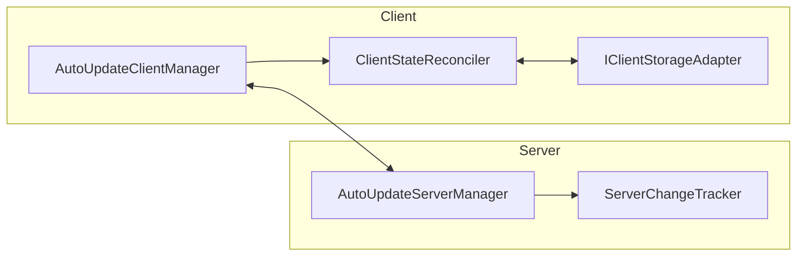

# Delta Synchronization Guide & Implementer Options

This document explains the DEM delta synchronization architecture.
It details state inspection methods, configuration options, and storage adapters.

---

## 1. Architecture Overview

DEM delta synchronization provides incremental state updates between server and client managers.
When enabled, the server records lifecycle mutations: `create`, `update`, and `delete`.
Each mutation increments a monotonic revision number.



---

## 2. Server Configuration and State Management

### 2.1 Configuration Options (`ServerDeltaSyncOptions`)

Pass `ServerDeltaSyncOptions` to `AUSManagerFactory`:

```typescript
import { ServerDeltaSyncOptions } from "@prestizni-software/dem-publisher";

const deltaSync: ServerDeltaSyncOptions = {
  enabled: true,                       // Enable change tracking
  maxAgeMs: 7 * 24 * 60 * 60 * 1000,  // Retain changes for 7 days
  maxSizeBytes: 10 * 1024 * 1024,      // Maximum memory limit (10 MB)
  maxEntries: 50000,                   // Maximum mutation count
  pruneMode: "either",                 // "either" = age OR size; "both" = age AND size
};
```

### 2.2 Manual State Inspection Methods

Access `changeTracker` on any `AutoUpdateServerManager` instance:

```typescript
const tracker = serverManager.changeTracker;

// Get the latest mutation revision number
const currentRevision = tracker.getCurrentRevision();

// Get the oldest retained revision number
const lowestRevision = tracker.getLowestRetainedRevision();

// Get estimated memory consumption in bytes
const byteSize = tracker.getEstimatedSizeBytes();

// Get total count of retained change records
const count = tracker.getEntryCount();

// Retrieve changes since a given revision
const result = tracker.getChangesSince(clientLastRevision);
if (result.isExpired) {
  // Client revision is too old; server will perform a full sync
} else {
  // Contains Array<ChangeEntry<T>>
  console.log(result.changes);
}
```

### 2.3 Runtime Controls

Adjust pruning limits dynamically or clear history:

```typescript
// Update limits and trigger immediate pruning
tracker.updateOptions({
  maxSizeBytes: 20 * 1024 * 1024,
  maxAgeMs: 14 * 24 * 60 * 60 * 1000,
});

// Run manual pruning immediately
tracker.prune();

// Clear all recorded change history
tracker.clear();
```

---

## 3. Client Configuration and State Management

### 3.1 Configuration Options (`ClientDeltaSyncOptions`)

Pass storage adapters to `AUCManagerFactory`:

```typescript
import {
  AUCManagerFactory,
  IndexedDbStorageAdapter,
} from "@prestizni-software/dem-publisher";

const storage = new IndexedDbStorageAdapter("dem_client_cache");

const clientManagers = await AUCManagerFactory(
  { Company: CompanyClient },
  loggers,
  clientSocket,
  false,
  undefined,
  {},
  undefined,
  { storage },
);
```

### 3.2 Manual Storage Inspection Methods

Inspect persistent data via the `IClientStorageAdapter` interface:

```typescript
// Load raw persisted state for a specific class
const state = await storage.loadManagerState("Company");
if (state) {
  console.log(state.revision);   // Stored revision number
  console.log(state.ids);        // Array of object IDs
  console.log(state.objects);    // Array of plain serialized objects
  console.log(state.savedAt);    // Unix timestamp of save
}
```

### 3.3 Manual Storage Mutation and Purge

Clear persisted caches on demand:

```typescript
// Delete cache for a single manager class
await storage.clearManagerState("Company");

// Delete all DEM client caches across all classes
await storage.clearAll();
```

### 3.4 Direct Reconciler Invocation

Use `ClientStateReconciler` for manual state restoration or delta application:

```typescript
import { ClientStateReconciler } from "@prestizni-software/dem-publisher";

// Restore client manager in-memory state from storage
const restoreResult = await ClientStateReconciler.restoreFromStorage(
  clientManager,
  storage,
);
console.log(restoreResult.restored, restoreResult.revision);

// Persist in-memory manager state to storage manually
await ClientStateReconciler.persistToStorage(
  clientManager,
  revisionNumber,
  storage,
);

// Apply a delta sync payload manually
await ClientStateReconciler.applyDelta(
  clientManager,
  deltaPayload,
  storage,
);
```

---

## 4. Pluggable Storage Adapters

DEM provides three built-in storage adapters implementing `IClientStorageAdapter`:

| Adapter | Target Environment | Storage Mechanism | Best Used For |
| :--- | :--- | :--- | :--- |
| `MemoryStorageAdapter` | Node.js / Browser | JavaScript Map (in-memory) | Unit tests, ephemeral sessions |
| `LocalStorageAdapter` | Browser | `window.localStorage` | Datasets under 5 MB |
| `IndexedDbStorageAdapter` | Browser | IndexedDB key-value store | Datasets larger than 10 MB |

### 4.1 Custom Storage Adapter Implementation

Create custom storage adapters by implementing `IClientStorageAdapter`:

```typescript
import {
  IClientStorageAdapter,
  StoredManagerState,
} from "@prestizni-software/dem-publisher";

export class CustomStorageAdapter implements IClientStorageAdapter {
  async saveManagerState<T>(className: string, state: StoredManagerState<T>): Promise<void> {
    // Persist state to custom storage (e.g. SQLite, MMKV, Redis)
  }

  async loadManagerState<T>(className: string): Promise<StoredManagerState<T> | null> {
    // Retrieve state from custom storage
    return null;
  }

  async clearManagerState(className: string): Promise<void> {
    // Remove state for specified class
  }

  async clearAll(): Promise<void> {
    // Remove all DEM cached states
  }
}
```

---

## 5. Synchronization Flow and Status Handlers

The startup protocol uses three states in `DeltaSyncPayload`:

1. `up-to-date`:
   Client revision equals server revision.
   The server sends no data.
   The client preserves in-memory objects.

2. `delta`:
   Client revision is within retained server range.
   The server sends mutation entries (`create`, `update`, `delete`).
   The client reconciler updates existing objects and persists new state.

3. `full`:
   Client revision is older than server retention or missing.
   The server sends complete object collection.
   The client wipes previous local cache and instantiates new objects.
